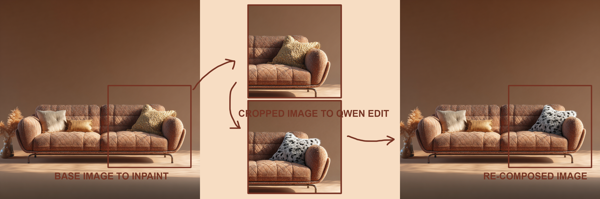

# Aioli Nodes — ComfyUI Custom Node Suite

Eight nodes for outpainting, inpainting and **multi-region** (SAM3 or hand-drawn) editing in ComfyUI — plus ready-to-run example workflows, including three that work out-of-the-box on **ComfyUI Cloud** (no install required).

> **1.7.1 —** **🖼️ Ratio Outpaint Calc** can pad a drawn mask exactly like the image (`mask` → `mask_padded`), and **🧱 Region Mask List** can add the outpaint bands as one more region (`extra_mask`) and turn "no region" into the whole image (`empty = full_image`). Outpaint and inpaint now run in the same pass. Fix: when rounding to `multiple` made the padded image *smaller* than the source on one side (a crop of a few pixels), the band `mask` was wrong — it now follows the image exactly. Prefer `multiple = none` when Aioli Mask BBox V2 handles the multiples downstream: it only ever enlarges.
>
> **1.7.0 —** New **📐 Aioli Mask BBox V2**: one geometry rule for regions, borders and whole images — the crop never cuts the bbox and is never stretched, grey bands fill in when the image is too small, and `resolution` is a pixel budget (square equivalent). **🧩 BBox Multiple Assembler** feather no longer lets the original back in at the image border. **✂️ Mask Split Regions** can turn an empty mask into the whole image, **🎨 Inpaint Color Fix** can ignore the bands. Existing workflows keep loading: the 1.6 node stays registered as *Aioli Mask BBox (legacy)*. The only visible change on old workflows is the feather at the image border (see [BBox Multiple Assembler](#-bbox-multiple-assembler)). See [Migrating from Aioli Mask BBox (legacy)](#migrating-from--aioli-mask-bbox-legacy).
>
> **1.6.0 —** `MaskBoundingBox+` (ComfyUI Essentials) and `BBox Multiple Fix` merged into a single node, now itself legacy.

---

## 💡 Why this approach? (TL;DR)

All workflows in this repo use the same core idea: **inpaint only the masked region, never the whole image**.

- **The source image's dimensions are preserved end-to-end.** Only the crop around the mask goes through the model / KSampler — so the full-resolution original never gets downscaled, stretched, or otherwise degraded to fit a generation budget.
- **More detail inside the masked region.** Since only the crop is generated, the model's entire budget (attention, denoising steps, resolution) is spent on that zone — not diluted across background pixels that aren't changing.
- **`force_square` avoids internal recrops.** Most image-edit models (nano-banana, Flux, Qwen-Edit, SDXL inpaint) quietly recrop or letterbox any non-1:1 input. Forcing the crop to be square before sending prevents this "pixel shift", keeping the output pixel-aligned with the source. When the square doesn't fit in the image, grey bands fill in — the crop is never stretched.
- **One path for everything.** Region, region with the whole image as context, whole image, outpaint: the same chain (Aioli Mask BBox V2 → model → BBox Multiple Assembler) — what it does follows from what you give it.
- **Pixel-perfect recompose.** After generation, the result is stitched back onto the untouched source at the exact original coordinates — no drift, no seams, no colour shift at the mask edges.

---

## Installation

### Via ComfyUI Registry (recommended)

Search **"Aioli Nodes"** directly in the ComfyUI Manager → Install Nodes.

### Via Git URL

```
https://github.com/aiolicollective/aioli-nodes
```

### Manual installation

1. Copy the `aioli-nodes` folder into `ComfyUI/custom_nodes/`
2. Restart ComfyUI
3. The nodes appear under the **Aioli Nodes** category

No extra dependencies — only `math` (Python stdlib), `torch`, `numpy`, `scipy` and `Pillow` (all already bundled with ComfyUI).

---

## 🖼️ Ratio Outpaint Calc

Prepares an image for outpainting to a standard aspect ratio.  
Automatically computes padding and generates the mask.

**Inputs**
| Parameter | Type | Description |
|-----------|------|-------------|
| image | IMAGE | Source image |
| ratio | dropdown | `none` · `1:1` · `4:5` · `5:4` · `3:4` · `4:3` · `16:9` · `9:16` |
| multiple | dropdown | `none` (legacy: ceil to 8 on the computed side) · `8` · `16` · `32` · `64` — both sides rounded to the nearest multiple |
| mask *(optional)* | MASK | A mask drawn on the source image — resized onto the image if needed, then padded **exactly** like it |

**Outputs**
| Output | Type | Description |
|--------|------|-------------|
| image_padded | IMAGE | Image padded with neutral grey (0.5) |
| mask | MASK | Binary mask (0 = keep, 1 = generate) — the outpaint bands |
| mask_padded | MASK | The input `mask`, aligned on `image_padded` (0 in the bands). All zeros when no mask is connected |

**Workflow**
```
Load Image → 🖼️ Ratio Outpaint Calc → VAE Encode (Inpaint) → KSampler
```

**Outpaint + inpaint in the same run** (1.7.1)
```
Load Image (image + mask) → 🖼️ Ratio Outpaint Calc
  ├── image_padded  → base image for 📐 Aioli Mask BBox V2 and 🧩 BBox Multiple Assembler
  ├── mask_padded   → ✂️ Mask Split Regions → 🧱 Region Mask List (masks)
  └── mask (bands)  ─────────────────────────→ 🧱 Region Mask List (extra_mask)
```

---

## 📐 Aioli Mask BBox V2

Takes the source image + mask, **finds the bbox itself** and returns the crop to send to the model — at a size the model likes, with **one geometry rule** for every case: a small masked region, a large one, a region touching the border, or the whole image.

- **The crop always contains the whole bbox.** It is the bbox grown to the model's aspect ratio, centred, pushed back inside the image.
- **Never stretched.** When the crop needs more room than the image has (a square crop on a 16:9 image, a region at the edge), **grey bands** fill the missing part instead. `x` / `y` can then be negative and `orig_width` / `orig_height` include the bands. **🧩 BBox Multiple Assembler** pastes back only the part that lies inside the image.
- **`resolution` is a pixel budget, not a side length.** `1024` means "as many pixels as 1024 × 1024", at the crop's ratio, sides rounded to `multiple`.
- **`context = full_image`** sends the whole image to the model but pastes back only the masked zone.

> Recompose with **🧩 BBox Multiple Assembler** (connect `x`, `y`, `orig_width` → `width`, `orig_height` → `height`). `ImageCompositeMasked` does not handle negative coordinates and no longer fits.

**Inputs**
| Parameter | Type | Description |
|-----------|------|-------------|
| image | IMAGE | Full source image |
| mask | MASK | Full source mask — resized onto the image if their definitions differ |
| padding | INT | Margin in pixels around the detected bbox. Ignored with `context = full_image`. Default: `48` |
| multiple | dropdown | `8 (VAE minimum)` · `16 (Flux)` · `32 (SD1.5)` · `64 (SDXL)` — the model-side dimensions are multiples of it. Default: `16` |
| resolution | INT (slider) | Model size as a **square equivalent**: as many pixels as N × N. Step 64, up to 4096 (warning above 2048). `0` = native size. Default: `1024` |
| force_square | BOOLEAN | Square model size. Bands fill in when the square doesn't fit in the image. Default: `False` |
| force_target_downscale | BOOLEAN | When the crop is larger than N², reduce it to N². Off: keep its native size, capped. Default: `False` |
| context | dropdown | `region` (crop around the mask) · `full_image` (crop = whole image, mask unchanged). Default: `region` |
| band_color *(optional)* | FLOAT | Grey level of the bands. Default: `0.5` |

**Outputs** — the nine outputs of the 1.6 node, same names, same order, plus `image_area`.
| Output | Type | Description |
|--------|------|-------------|
| image_cropped | IMAGE | Crop at model size (bands included) |
| mask_cropped | MASK | Mask crop at model size (0 in the bands) |
| x / y | INT | Top-left of the crop in the source — **can be negative** (bands) |
| orig_width / orig_height | INT | Crop size in the source, bands included → assembler `width` / `height` |
| width / height | INT | Size sent to the model |
| target_size | INT | `resolution` (0 = none) |
| image_area | MASK | At model size: 1 on image pixels, 0 on the bands and the thin resize fringe next to them → **🎨 Inpaint Color Fix** `measure_area` |

**Model size**

| Situation | Model size |
|-----------|------------|
| crop smaller than N² | upscaled to N² |
| crop larger than N², `force_target_downscale = True` | downscaled to N² |
| crop larger than N², `force_target_downscale = False` | native size (rounded up to `multiple`), capped |
| `resolution = 0` | native size, capped |
| cap | 2048² pixels (4.2 MP), or N² when N > 2048 |

N² is reached by the pair of multiples closest to the crop's ratio, within ±5 % of N² pixels. A square is always exactly N × N. The model size is never more elongated than 4:1 — a thinner region gets extra context on its short side.

| `resolution` | `multiple` | 1:1 | 3:2 | 4:3 | 16:9 |
|---|---|---|---|---|---|
| 1024 | 16 | 1024×1024 | 1248×832 | 1200×896 | 1392×784 |
| 1536 | 32 | 1536×1536 | 1920×1280 | 1792×1344 | 2048×1152 |
| 2048 | 16 | 2048×2048 | 2496×1664 | 2368×1776 | 2704×1520 |
| 2048 | 64 | 2048×2048 | 2496×1664 | 2368×1792 | 2752×1536 |

> **Whole image and `force_target_downscale = False`:** a whole image is usually larger than N², so it goes to the model at its native size capped at 4.2 MP — `resolution` then has no visible effect. Turn `force_target_downscale` on to send it at N².

> **Thin bands on whole images.** Rounding to `multiple` rarely matches the image ratio exactly, so a whole image usually gets a few pixels of band (1–2 px at ×16, up to ~15 px at ×64). They are dropped at recompose.

> **Empty mask:** the bbox falls back to the whole image and the mask stays black (warning in the log). To edit the whole image when nothing is painted, use **✂️ Mask Split Regions** with `empty_mask = full_image`.

**What you give → what it does**

| Input | Settings | Result |
|-------|----------|--------|
| Drawn or SAM3 mask | `context = region` | Inpaint per region, crop + `padding` |
| Mask | `context = full_image` | The model sees the whole image, only the masked zones are pasted back |
| No mask | Mask Split Regions `empty_mask = full_image` | The whole image is edited |
| 🖼️ Ratio Outpaint Calc | base = `image_padded`, its `mask` → Region Mask List `extra_mask` | Only the padded bands are generated, the whole image as context |
| Outpaint + drawn mask | the drawn mask through `mask_padded` → Mask Split Regions | Outpaint and inpaint in the same run |

**Workflow**
```
✂️ Mask Split Regions / 🧱 Region Mask List
  └→ 📐 Aioli Mask BBox V2 ── image_cropped → model → 🎨 Inpaint Color Fix ← image_area
        │                                                   │
        └── x, y, orig_width, orig_height ──→ 🧩 BBox Multiple Assembler
```

### Migrating from 📐 Aioli Mask BBox (legacy)

`AioliMaskBBox` (1.6) is **still registered under the same key, with the same inputs and outputs**: existing workflows load and run exactly as before. It is only marked deprecated — recent ComfyUI frontends hide it from the node search — and shown as *Aioli Mask BBox (legacy)*.

To migrate a workflow:

1. Replace it with **📐 Aioli Mask BBox V2**, connect `image` and `mask`.
2. Reconnect the nine outputs — same names, same order.
3. Set `resolution` to the old `target` value (`none` → `0`). It now counts pixels, not the long side: a 3:2 crop at `1024` becomes 1248×832 instead of 1024×688.
4. Recompose with **🧩 BBox Multiple Assembler** (`orig_width` / `orig_height` → `width` / `height`). Drop any `ImageResize+` in stretch mode and `ImageCompositeMasked` — the assembler resizes the crop back itself.
5. Optional: wire `image_area` into **🎨 Inpaint Color Fix** `measure_area`.

Why a new node rather than an update: changing `target` from a dropdown to an INT would break every saved workflow (`"none"` can't be read as a number), and the old node could, without `force_square`, **cut the bbox** (crop smaller than the bbox when a target was set) or **leave strips of the original** on whole-image crops. V2 fixes both by construction.

<details>
<summary>Legacy 📐 Aioli Mask BBox (1.6) — reference</summary>

| Parameter | Type | Description |
|-----------|------|-------------|
| padding | INT | Margin in pixels around the detected bbox. Default: `0` |
| multiple | dropdown | `8 (VAE minimum)` · `16 (Flux)` · `32 (SD1.5)` · `64 (SDXL)` |
| target | dropdown | `none` · `512` · `768` · `1024` · `1536` · `2048` — long side |
| force_square | BOOLEAN | Crop squared to max(width, height). If the square doesn't fit in the image, the crop becomes a rectangle stretched to the square target |
| force_target_downscale | BOOLEAN | If bbox > target, downscale toward target. Default: `False` — fallback to a 2048 px cap |

Outputs: `image_cropped`, `mask_cropped`, `x`, `y`, `orig_width`, `orig_height`, `width`, `height`, `target_size` — designed for `ImageResize+` → `ImageCompositeMasked`.

</details>

### Migrating from 📐 BBox Multiple Fix

`BBoxMultipleFix` (1.5) is also still registered, same key, same inputs and outputs: old workflows keep running unchanged. To migrate, replace the pair `MaskBoundingBox+` (ComfyUI Essentials, [maintenance-only since April 2025](https://github.com/cubiq/ComfyUI_essentials#readme)) → `BBox Multiple Fix` by one **📐 Aioli Mask BBox V2** and follow the steps above. If `MaskBoundingBox+` had `blur > 0`, carry that value over to `padding` — blur only widened the bbox.

---

## 🎨 Inpaint Color Fix

Plugs in right after **VAE Decode**, before **🧩 BBox Multiple Assembler**.

Corrects colorimetric drift introduced by the generation — selectively applies a LAB color match only on pixels that haven't significantly changed, leaving truly creative pixels untouched. No external dependencies (pure numpy + torch).

**Inputs**
| Parameter | Type | Description |
|-----------|------|-------------|
| original_crop | IMAGE | `image_cropped` from 📐 Aioli Mask BBox V2 (before KSampler) |
| inpainted_crop | IMAGE | IMAGE from VAE Decode |
| delta_e_threshold | FLOAT | Similarity threshold (-1 = auto). Below = corrected, above = creative/intact |
| blend_strength | FLOAT | Color match strength on similar zones (0 = none, 1 = full) |
| feather_radius | INT | Gaussian blur radius on the correction mask (0 = disabled) |
| mask *(optional)* | MASK | Override mode: bypasses Delta-E entirely, the mask drives correction directly |
| measure_area *(optional)* | MASK | Pixels used for the statistics (auto threshold, colour match). Connect `image_area` from 📐 Aioli Mask BBox V2 so the grey bands don't skew the correction. Unconnected: the whole crop, as before |

**Outputs**
| Output | Type | Description |
|--------|------|-------------|
| image_corrected | IMAGE | Color-corrected crop — connect to the assembler `crops` |
| correction_mask | MASK | Debug mask (white = corrected, black = creative/intact) |

**Modes**

| Mode | Behaviour |
|------|-----------|
| No mask connected | Delta-E auto-detects similar vs creative pixels |
| Mask connected | Delta-E is bypassed — the mask controls correction directly |

**Delta-E threshold guide**

| Value | Effect |
|-------|--------|
| `-1` (auto) | Recommended starting point |
| `5–10` | Strict — corrects almost everything except highly creative pixels |
| `15–20` | Balanced — fixes subtle drift, preserves real changes |
| `25–35` | Loose — only corrects near-identical pixels |
| `50+` | Near-global color match |

**Position in workflow**
```
📐 Aioli Mask BBox V2
  ├── image_cropped → KSampler → VAEDecode → 🎨 InpaintColorFix → 🧩 BBox Multiple Assembler
  └── image_area ─────────────────────────────────↑ (measure_area)
```

---

## 🧩 BBox Multiple Assembler

Multi-region recompose — the list-aware successor to `ImageCompositeMasked`. Stitches a **list of N inpainted crops** back onto a single base image, each at its own bbox, with per-layer mask growth, feathering, opacity and z-ordering. Used when several masked regions (SAM3 masks, or hand-drawn blobs split by **Mask Split Regions**) are each cropped, enhanced separately in the KSampler, then merged. `INPUT_IS_LIST` — maps over the N crops/masks/coords automatically.

**Key behaviour:** `mask_adjust` operates on the **full image canvas** (image-bounded, not crop-bounded), so a region can be grown/shrunk *after* generation without re-running the sampler. Compositing happens only inside each crop rectangle — where a grown mask spills past the crop, the layer below shows through (true per-hierarchy transparency), never an imposed base-image overwrite. Separable grow/feather + downscale keep it fast even at large radii.

**Inputs**
| Parameter | Type | Description |
|-----------|------|-------------|
| base_image | IMAGE | Full-resolution untouched source |
| crops | IMAGE (list) | The N enhanced crops |
| masks | MASK (list) | The N per-region masks |
| x / y | INT (list) | Top-left of each crop in the source — negative values are fine (bands) |
| width / height | INT (list) | Size of each crop in the source → `orig_width` / `orig_height` of 📐 Aioli Mask BBox V2. Crops at another size are resized back (Lanczos) |
| order | dropdown | `list_first_on_top` (last list item = bottom layer → put the background mask last) · `area_large_under` (large zones under, auto) |
| mask_adjust | INT | Grow (+) / shrink (−) each mask on the full canvas. Default `0` |
| feather | INT | Gaussian edge softening. Default `8` |
| opacity | FLOAT | Per-layer opacity. Default `1.0` |

**Outputs**
| Output | Type | Description |
|--------|------|-------------|
| image | IMAGE | Final recomposed image |
| combined_mask | MASK | Union of all composited regions |
| checker | IMAGE | Debug view with coloured region outlines |

> The `checker` outline is always drawn (frozen internally, not exposed as a widget) — turning it off only made `checker` a duplicate of `image`.

> Proven byte-identical to `ImageCompositeMasked` for a single region with `feather = 0, mask_adjust = 0`.

> **1.7.0 — feather at the image border.** The feather used to treat everything outside the image as black: a mask touching the border dropped to ~0.53 there (~0.28 in a corner, feather 8) and the original came back along the edge. The border now extends the mask as it is: a mask touching the border stays at 1, a mask stopping short of it is not pushed up. Old workflows render differently **at the image border only** — an improvement. **👁 Region Preview** follows (same function).

---

## 👁 Region Preview

Preview — **before any generation** — exactly what **BBox Multiple Assembler** only outputs at the very end. Branch it as a **side-channel** right after **Region Mask List** or **Mask Split Regions**; it never touches the list pipeline that already works. It reuses the assembler's **exact math** (the same imported `_grow_shrink_fast` / `_feather_fast` / `_resize_mask` / `_PALETTE` helpers), so **the preview equals the final render**.

It also doubles as a **single tuning point**: set `mask_adjust` / `feather` / `opacity` here, look at the result, then wire those same outputs straight back into **BBox Multiple Assembler** (convert its widgets to inputs). `INPUT_IS_LIST` — maps over the mask list like the assembler; singletons taken at `[0]`.

Masks are full-size (the usual output of Region Mask List / Mask Split Regions, already positioned on the canvas), so no coordinates are needed.

**Inputs**
| Parameter | Type | Description |
|-----------|------|-------------|
| base_image | IMAGE | The base image to preview the regions on |
| masks | MASK (list) | The regional masks (full-size) |
| mask_adjust | INT | Grow (+) / shrink (−) each mask on the full canvas. Default `0` |
| feather | INT | Gaussian edge softening. Default `8` |
| opacity | FLOAT | Per-layer opacity. Default `1.0` |

**Outputs**
| Output | Type | Description |
|--------|------|-------------|
| combined_mask | MASK | Union of all masks with `mask_adjust` / `feather` / `opacity` applied **exactly like the assembler** |
| checker | IMAGE | Base image + per-region coloured outline & light fill, to see what you're working on |
| mask_adjust | INT | Pass-through — rewire into BBox Multiple Assembler |
| feather | INT | Pass-through — rewire into BBox Multiple Assembler |
| opacity | FLOAT | Pass-through — rewire into BBox Multiple Assembler |

**Position in workflow (side branch)**
```
Region Mask List ──┬─→ … per-region crop → KSampler → BBox Multiple Assembler   (main list pipeline, untouched)
                   └─→ 👁 Region Preview                                         (side branch — visualise before generating)
```

> **Re-wiring back into the assembler.** `mask_adjust` (INT), `feather` (INT) and `opacity` (FLOAT) wire cleanly into the assembler's matching inputs (convert its widgets to inputs). `order` is not exposed here — ComfyUI can't link a node output into a combo input, and order doesn't change the preview — so set it directly on the assembler. The debug outline is always on (frozen, not exposed) — without it the `checker` would show nothing.

---

## 🧱 Region Mask List

Prepares the **list of regional masks** for a SAM3 multi-region pipeline. Takes the N SAM3 masks (batch *or* list), flattens them into a clean full-size list in the received order, and optionally appends a **background mask** (the inverse of the union of all masks) as the **last** element. `INPUT_IS_LIST` · `OUTPUT_IS_LIST = (True, False, False)`.

The last element being the background pairs with **BBox Multiple Assembler**'s `list_first_on_top` ordering (last = bottom layer), so the background stays under the objects. The same list feeds **📐 Aioli Mask BBox V2** (per-region crop + coords), the per-region Gemma caption, the KSampler (N passes) and **Regional Mask Conditioning**.

**Inputs**
| Parameter | Type | Description |
|-----------|------|-------------|
| masks | MASK (batch/list) | The SAM3 masks |
| add_background | BOOLEAN | Append the inverse-union background mask last. Default `True` |
| threshold | FLOAT | Binarisation cutoff used **only** to compute the background (inverse union). No effect on the object masks, and none at all when `add_background = False`. Default `0.5` |
| min_bg_area | FLOAT | Skip the background if it covers less than this fraction of the image. Default `0.0` |
| extra_mask *(optional)* | MASK | Added **as is** as one more region, after the others (before the background). Typically the bands from 🖼️ Ratio Outpaint Calc: one region, the whole image as context, next to drawn or SAM3 masks |
| empty | dropdown | `keep` (default, as before): empty masks pass through · `full_image`: empty masks (nothing ≥ `threshold`) are dropped, and if no region is left the list becomes **one full mask** — no mask = the whole image is edited |

**Outputs**
| Output | Type | Description |
|--------|------|-------------|
| masks | MASK (list) | The N (+1) regional masks |
| background_mask | MASK | The computed inverse-union background |
| count | INT | Number of layers out |

---

## 🗺️ Regional Mask Conditioning

Folds a **list of (conditioning, mask)** pairs into a **single regional conditioning** for a one-pass KSampler generation (regional prompting, TTP-style — except the "tiles" are your SAM3 / hand-drawn masks). Each `(caption_i, mask_i)` becomes a `Conditioning (Set Mask)` and all are concatenated — ComfyUI can't fold a dynamic list of N on its own, this node does it for any N. **Broadcast:** supply a single conditioning for N masks and it is applied to every region (handy for a single prompt / debugging). `INPUT_IS_LIST`.

**Optional global layer.** Connect a `base_conditioning` — a prompt describing the **whole image** — and it is applied over the full frame, blended with the regional prompts via `base_strength` (its `mask_strength`). Inside a region the pixel gets a weighted mix of `base_strength` (global) vs `strength` (region); outside every region the global applies alone. Leave `base_strength = 0` or the input unconnected for pure regional behaviour (unchanged). The blend happens at the sampler level via `mask_strength`, so prompts of different lengths mix cleanly — no tensor interpolation.

**Inputs**
| Parameter | Type | Description |
|-----------|------|-------------|
| conditioning | CONDITIONING (list) | One per region, or a single one to broadcast to all |
| masks | MASK (list) | The regional masks |
| strength | FLOAT | `mask_strength` per region. Default `1.0` |
| set_area_to_bounds | BOOLEAN | Restrict each region's compute to its mask bbox — **faster** when regions are small. Default `False` |
| base_conditioning *(optional)* | CONDITIONING | A global prompt describing the whole image, blended over the regions |
| base_strength | FLOAT | Weight of the global layer (its `mask_strength`). `0` = no global. Default `0.5` |

**Outputs**
| Output | Type | Description |
|--------|------|-------------|
| conditioning | CONDITIONING | The combined regional (+ optional global) conditioning |
| covered_mask | MASK | Union of all region masks (debug) |

> **Performance.** Regional conditioning is inherently ~N× slower than a single global prompt: the sampler runs one model forward pass per distinct masked prompt, per step (N regions + the optional global = N+1 passes). With DyPE at high resolution each pass is costly, so keep the region count down and set `set_area_to_bounds = True` to limit each region's compute to its bounding box.

---

## ✂️ Mask Split Regions

Splits **one hand-drawn mask** into **N separate masks**, one per disconnected blob (connected-component labelling). Each painted region then gets its own bbox / crop / prompt — manual multi-region inpaint, exactly like SAM3 but **keyword-free**. A single connected blob → 1 mask (identical to a normal single-region inpaint). Output is a **list**, so it drops straight into **📐 Aioli Mask BBox V2**, which maps over it. Uses `scipy.ndimage` — already bundled with ComfyUI, no install. `OUTPUT_IS_LIST = (True, False)`.

**Inputs**
| Parameter | Type | Description |
|-----------|------|-------------|
| mask | MASK | The single hand-drawn mask (may contain several disconnected blobs) |
| threshold | FLOAT | Binarisation of the drawn mask. Default `0.5` |
| min_area | INT | Ignore blobs smaller than this many pixels (anti stray-dots). Default `64` |
| sort_by | dropdown | `area_desc` (default, largest first) · `area_asc` · `top_to_bottom` · `left_to_right` |
| empty_mask | dropdown | What an empty mask gives. `nothing` (default, as before): 1 black region, `count = 0` · `full_image`: 1 full region, `count = 1` — nothing painted = the whole image is edited. "Empty" is judged **after** `threshold`: a mask painted below it everywhere counts as empty |

**Outputs**
| Output | Type | Description |
|--------|------|-------------|
| masks | MASK (list) | One full-size mask per detected region |
| count | INT | Number of regions found |

**Position in workflow (manual branch)**
```
ImageToMask → ✂️ Mask Split Regions → 📐 Aioli Mask BBox V2 → … per-region inpaint
```

> **Only four widgets are exposed** — `threshold`, `min_area`, `sort_by`, `empty_mask`. Two parameters are kept as fixed defaults in the node code to keep the canvas clean: `connectivity = 8` (diagonals count — correct for virtually all hand-drawn masks) and `merge_distance = 0` (no stroke merging). Edit `mask_split_regions.py` if you ever need to change them.

---

## ☁️ ComfyCloud-compatible workflows (no install required)

If you don't want to install the custom node locally — or if you're running **ComfyUI Cloud** where custom nodes aren't available — there are three pure-subgraph workflows that reproduce the `BBoxMultipleFix` behaviour using only pre-installed nodes.

They all package the same reusable subgraph **`Aioli Node Subgraph — BBox Fix`**, which wires together `MaskBoundingBox+`, `ComfyMathExpression`, `ImageCrop+`, `ImageResize+`, `ImagePadForOutpaint`, `MaskComposite`, `GrowMaskWithBlur`, `SolidMask`, `ImpactSwitch`, `BatchImagesNode`, and `CropMask` to deliver the same features:

- **force_square** · **inpaint_mode** (zone / whole image) · **use_mask_blur**
- **multiple** alignment (with floor-after-clamp, no drift)
- **target_size** (0 = none with 2048 cap, or 512 / 768 / 1024 / 1536 / 2048)
- Anti-clamp guarantee
- Pixel-perfect recompose via `ImageCompositeMasked`
- **Auto 1:1 padding** in whole-image mode (v2): pads source to a square before sending to the model, then strips the padding off — prevents the model from internally recropping non-square images
- **Optional second reference image** (v3, nano-banana only): batch a style-reference image alongside the crop for multi-image prompting — with a `use_image2` toggle that safely bypasses the batch when disabled

### Three flavours, one per inpainting model

#### 🍌 nano-banana (Gemini Image) — v3

The lightest variant: just an API call to Gemini Image, no local diffusion weights needed. Includes the v3 `image2` input for multi-image prompting.

> **[⬇ Download workflow](examples/WF_Inpaint_aioli-subgraph_ComfyCloud_nano-banana.json)**  
> **[🚀 Try it live — "NanoInpaint — CropNStitch" on ComfyUI Cloud](https://cloud.comfy.org/?share=2f8ca539ed1a)** *(optimised for the Cloud app runtime — no setup, just paint & run)*


#### 🌀 Flux.2 Klein 9B

Full local diffusion pipeline using the official ComfyUI Flux.2 Klein inpaint template, combined with the BBox Fix subgraph for pixel-perfect crop & recompose.

> **[⬇ Download workflow](examples/WF_Inpaint_aioli-subgraph_ComfyCloud_Flux2Klein.json)**


#### 🏮 Qwen Image Edit 2511

Same idea as Flux2Klein but using the Qwen Image Edit 2511 template — a different diffusion model, same BBox Fix subgraph wrapper.

> **[⬇ Download workflow](examples/WF_Inpaint_aioli-subgraph_ComfyCloud_QwenImageEdit_2511.json)**



### Subgraph widgets (all three workflows)

| Widget | Default | Purpose |
|---|---|---|
| `force_square` | `True` | Force crop to 1:1 ratio (avoids model-internal recrop) |
| `inpaint_mode` | `True` | `True` = zone mode (crop around mask) · `False` = whole-image mode (pad source to 1:1, send everything, crop back) |
| `use_mask_blur` | `False` | Apply `GrowMaskWithBlur` before bbox detection |
| `multiple` | `16` | Dimension alignment (16/32/64 for VAE; 0/1 disables) |
| `target_size` | `0` | Long-side target: `0` = none (cap 2048) · `512` · `768` · `1024` · `1536` · `2048` |
| `use_image2` *(nano-banana v3 only)* | `False` | Batch a second reference image alongside the crop |

### Running locally?

The nano-banana example uses `LoadImageOutput`, which works out-of-the-box on ComfyUI Cloud but may not be available in some local setups. If you hit an error on load, just replace that node with a standard `Load Image` node — everything else stays the same.

---

## 🔁 Example Workflow — Multi-region edit (Flux.2 Klein)

> **[⬇ Download workflow JSON](examples/aioli_INPAINT_Img_Flux2_Klein_multi-region-edit.json)**

A complete **multi-region** inpaint workflow for **Flux.2 Klein** (9B) that exercises most of this repo's inpaint nodes at once: several masked regions are each cropped, prompted and denoised **independently**, then recomposed pixel-perfectly onto the untouched source. Regions can come from **SAM3** masks or from a single hand-drawn mask split by **✂️ Mask Split Regions** — either way they flow through **🧱 Region Mask List**, get cropped by **📐 Aioli Mask BBox**, enhanced per region in the KSampler, colour-matched by **🎨 Inpaint Color Fix**, and merged by **🧩 BBox Multiple Assembler**. **👁 Region Preview** lets you check the layout *before* generating.

**Regions → mask → recompose**

The assembler's `checker` shows each region outlined in its own colour, `combined_mask` is the union of all regions, and the final `image` is the recomposed result — every region stitched back at its exact coordinates with no seam or colour drift.


*`checker` — each masked region outlined in its own colour (also previewable up-front with 👁 Region Preview).*


*`combined_mask` — the union of all region masks, with `mask_adjust` / `feather` applied.*


*Final `image` — each region enhanced independently, recomposed pixel-perfectly onto the source.*

**Pipeline**
```
Load Image (+ SAM3 masks  OR  hand-drawn mask → ✂️ Mask Split Regions)
  └→ 🧱 Region Mask List                (clean list + optional background, last)
        ├─→ 👁 Region Preview            (side branch — combined_mask / checker before generating)
        └─→ 📐 Aioli Mask BBox                 (per-region bbox + crop + coords — V2 in new workflows)
              └→ VAE Encode → KSampler   (N passes, one per region, per-region prompt)
                    └→ VAE Decode → 🎨 Inpaint Color Fix       (selective LAB colour match)
                          └→ 🧩 BBox Multiple Assembler         (recompose N crops → image / combined_mask / checker)
```

**Required models**
| Role | File |
|------|------|
| UNet | `flux2/flux-2-klein-9b-fp8.safetensors` |
| VAE | `flux2/flux2-vae.safetensors` |
| Text encoder | `qwen_3_8b_fp8mixed.safetensors` |

**Aioli nodes showcased**
`MaskSplitRegions` · `RegionMaskList` · `AioliMaskBBox` · `InpaintColorFix` · `BBoxMultipleAssembler` · `RegionPreview` — plus **ComfyUI Essentials** (`ImageResize+`) and **ComfyUI KJNodes** (`GrowMaskWithBlur`). *(The published JSON still wires `MaskBoundingBox+` → `BBoxMultipleFix`; both still work — see [Migrating from BBox Multiple Fix](#migrating-from--bbox-multiple-fix). New examples built on Aioli Mask BBox V2 are coming.)*

**Usage**
1. Download the JSON and drag it into ComfyUI
2. Provide your image and either SAM3 masks or a hand-drawn mask (split automatically into regions)
3. Give each region its own prompt
4. Run — every region is enhanced on its own and recomposed pixel-perfectly onto the source

---

## 👋 About

These nodes and workflows are built and maintained by the **aioli collective** — a creative studio exploring what's next for AI-assisted image work.

If this saved you time or inspired something, a ⭐ on the repo goes a long way. You can also follow us to see what we're cooking next:

🌐 [aiolicollective.com](https://aiolicollective.com/) · 📷 [@aioli.collective](https://www.instagram.com/aioli.collective/)

Feedback, bug reports, and pull requests are always welcome via [GitHub Issues](https://github.com/aiolicollective/aioli-nodes/issues).
