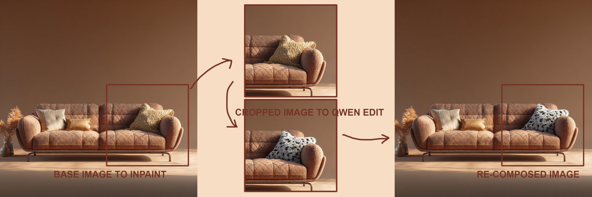

# Aioli Nodes — ComfyUI Custom Node Suite

Nodes for outpainting, inpainting and **multi-region** (SAM3 or hand-drawn) editing in ComfyUI, with one promise: **zero pixel shift and zero colour drift on everything that is not regenerated** — plus a **📏 Resolution Panel** that shows, live, how the image is scaled, padded and cropped, a frame-exact **🎞️ Video Compare**, and ready-to-run example workflows (Flux 3 Klein, Qwen Image 2.1, Nano Banana), plus older ones that work out-of-the-box on **ComfyUI Cloud** (no install required).

> **1.8.0 —** New **📏 Resolution Panel**: set the sizing of the chain and see it to scale, live, before running (legacy canvas and Nodes 2.0). New **🎞️ Video Compare**: two clips (VIDEO or IMAGE batch) side by side, wipe, difference, toggle, frame-exact play / step, lossless full-resolution frames on pause. New example workflows (Flux 3 Klein, Qwen Image 2.1, Nano Banana) wired to the panel, with a **MASKED LATENT** test switch. **🧩 BBox Multiple Assembler** / **👁 Region Preview**: `feather` now fades **outward** from the mask — the mask stays at 100 % up to its edge, and `mask_adjust = −feather` touches nothing outside the drawn stroke. **📐 Aioli Mask BBox** (key `AioliMaskBBoxV2` unchanged, no longer displayed "V2"): no more grey fringe at the image border when the crop has bands and is resized, and the mask stays full up to the image border. Batches > 1 are processed image by image (only the first image came out before). Rounding instead of truncation before every Lanczos resize (a −0.5 level bias in pasted zones is gone). Assembler 2–6× faster. Legacy nodes render bit-identically to 1.7.1. **Visible changes on existing workflows:** the feather (now outward), the image border when the crop has bands, ≤ 1 level from rounding. MIT licence file added; tests in `tests/`.

> **1.7.1 —** **🖼️ Ratio Outpaint Calc** can pad a drawn mask exactly like the image (`mask` → `mask_padded`), and **🧱 Region Mask List** can add the outpaint bands as one more region (`extra_mask`) and turn "no region" into the whole image (`empty = full_image`). Outpaint and inpaint now run in the same pass. Fix: when rounding to `multiple` made the padded image *smaller* than the source on one side (a crop of a few pixels), the band `mask` was wrong — it now follows the image exactly. Prefer `multiple = none` when Aioli Mask BBox handles the multiples downstream: it only ever enlarges.
>
> **1.7.0 —** New **📐 Aioli Mask BBox V2** (displayed **📐 Aioli Mask BBox** since 1.8.0, same key `AioliMaskBBoxV2`): one geometry rule for regions, borders and whole images — the crop never cuts the bbox and is never stretched, grey bands fill in when the image is too small, and `resolution` is a pixel budget (square equivalent). **🧩 BBox Multiple Assembler** feather no longer lets the original back in at the image border. **✂️ Mask Split Regions** can turn an empty mask into the whole image, **🎨 Inpaint Color Fix** can ignore the bands. Existing workflows keep loading: the 1.6 node stays registered as *Aioli Mask BBox (legacy)*. The only visible change on old workflows is the feather at the image border (see [BBox Multiple Assembler](#-bbox-multiple-assembler)). See [Migrating from Aioli Mask BBox (legacy)](#migrating-from--aioli-mask-bbox-legacy).
>
> **1.6.0 —** `MaskBoundingBox+` (ComfyUI Essentials) and `BBox Multiple Fix` merged into a single node, now itself legacy.

---

## 💡 Why this approach? (TL;DR)

All workflows in this repo use the same core idea: **inpaint only the masked region, never the whole image**.

- **The source image's dimensions are preserved end-to-end.** Only the crop around the mask goes through the model / KSampler — so the full-resolution original never gets downscaled, stretched, or otherwise degraded to fit a generation budget.
- **More detail inside the masked region.** Since only the crop is generated, the model's entire budget (attention, denoising steps, resolution) is spent on that zone — not diluted across background pixels that aren't changing.
- **`force_square` avoids internal recrops.** Most image-edit models (nano-banana, Flux, Qwen-Edit, SDXL inpaint) quietly recrop or letterbox any non-1:1 input. Forcing the crop to be square before sending prevents this "pixel shift", keeping the output pixel-aligned with the source. When the square doesn't fit in the image, grey bands fill in — the crop is never stretched.
- **One path for everything.** Region, region with the whole image as context, whole image, outpaint: the same chain (Aioli Mask BBox → model → BBox Multiple Assembler) — what it does follows from what you give it.
- **Pixel-perfect recompose.** After generation, the result is stitched back onto the untouched source at the exact original coordinates — no drift, no seams, no colour shift at the mask edges.

---

## Installation

### Via ComfyUI Registry (recommended)

Search **"Aioli Nodes"** directly in the ComfyUI Manager → Install Nodes.

### Via Git URL

```
https://github.com/aiolicollective/aioli-nodes
```

### Manual installation

1. Copy the `aioli-nodes` folder into `ComfyUI/custom_nodes/`
2. Restart ComfyUI
3. The nodes appear under the **Aioli Nodes** category

No extra dependencies — only `math` (Python stdlib), `torch`, `numpy`, `scipy` and `Pillow` (all already bundled with ComfyUI).

---

## 🖼️ Ratio Outpaint Calc

Prepares an image for outpainting to a standard aspect ratio.  
Automatically computes padding and generates the mask.

**Inputs**
| Parameter | Type | Description |
|-----------|------|-------------|
| image | IMAGE | Source image |
| ratio | dropdown | `none` · `1:1` · `4:5` · `5:4` · `3:4` · `4:3` · `16:9` · `9:16` |
| multiple | dropdown | `none` (legacy: ceil to 8 on the computed side) · `8` · `16` · `32` · `64` — both sides rounded to the nearest multiple |
| mask *(optional)* | MASK | A mask drawn on the source image — resized onto the image if needed, then padded **exactly** like it |

**Outputs**
| Output | Type | Description |
|--------|------|-------------|
| image_padded | IMAGE | Image padded with neutral grey (0.5) |
| mask | MASK | Binary mask (0 = keep, 1 = generate) — the outpaint bands |
| mask_padded | MASK | The input `mask`, aligned on `image_padded` (0 in the bands). All zeros when no mask is connected |

**Workflow**
```
Load Image → 🖼️ Ratio Outpaint Calc → VAE Encode (Inpaint) → KSampler
```

**Outpaint + inpaint in the same run** (1.7.1)
```
Load Image (image + mask) → 🖼️ Ratio Outpaint Calc
  ├── image_padded  → base image for 📐 Aioli Mask BBox and 🧩 BBox Multiple Assembler
  ├── mask_padded   → ✂️ Mask Split Regions → 🧱 Region Mask List (masks)
  └── mask (bands)  ─────────────────────────→ 🧱 Region Mask List (extra_mask)
```

---

## 📐 Aioli Mask BBox

*Key `AioliMaskBBoxV2` (displayed "V2" in 1.7.x). Not to be confused with the 1.6 node, kept as **📐 Aioli Mask BBox (legacy)**.*

Takes the source image + mask, **finds the bbox itself** and returns the crop to send to the model — at a size the model likes, with **one geometry rule** for every case: a small masked region, a large one, a region touching the border, or the whole image.

- **The crop always contains the whole bbox.** It is the bbox grown to the model's aspect ratio, centred, pushed back inside the image.
- **Never stretched.** When the crop needs more room than the image has (a square crop on a 16:9 image, a region at the edge), **grey bands** fill the missing part instead. `x` / `y` can then be negative and `orig_width` / `orig_height` include the bands. **🧩 BBox Multiple Assembler** pastes back only the part that lies inside the image.
- **`resolution` is a pixel budget, not a side length.** `1024` means "as many pixels as 1024 × 1024", at the crop's ratio, sides rounded to `multiple`.
- **`context = full_image`** sends the whole image to the model but pastes back only the masked zone.

> Recompose with **🧩 BBox Multiple Assembler** (connect `x`, `y`, `orig_width` → `width`, `orig_height` → `height`). `ImageCompositeMasked` does not handle negative coordinates and no longer fits.

**Inputs**
| Parameter | Type | Description |
|-----------|------|-------------|
| image | IMAGE | Full source image |
| mask | MASK | Full source mask — resized onto the image if their definitions differ |
| padding | INT | Margin in pixels around the detected bbox. Ignored with `context = full_image`. Default: `48` |
| multiple | dropdown | `8 (VAE minimum)` · `16 (Flux)` · `32 (SD1.5)` · `64 (SDXL)` — the model-side dimensions are multiples of it. Default: `16` |
| resolution | INT (slider) | Model size as a **square equivalent**: as many pixels as N × N. Step 64, up to 4096 (warning above 2048). `0` = native size. Default: `1024` |
| force_square | BOOLEAN | Square model size. Bands fill in when the square doesn't fit in the image. Default: `False` |
| force_target_downscale | BOOLEAN | When the crop is larger than N², reduce it to N². Off: keep its native size, capped. Default: `False` |
| context | dropdown | `region` (crop around the mask) · `full_image` (crop = whole image, mask unchanged). Default: `region` |
| band_color *(optional)* | FLOAT | Grey level of the bands. Default: `0.5` |

**Outputs** — the nine outputs of the 1.6 node, same names, same order, plus `image_area`.
| Output | Type | Description |
|--------|------|-------------|
| image_cropped | IMAGE | Crop at model size (bands included) |
| mask_cropped | MASK | Mask crop at model size (0 in the bands) |
| x / y | INT | Top-left of the crop in the source — **can be negative** (bands) |
| orig_width / orig_height | INT | Crop size in the source, bands included → assembler `width` / `height` |
| width / height | INT | Size sent to the model |
| target_size | INT | `resolution` (0 = none) |
| image_area | MASK | At model size: 1 on image pixels, 0 on the bands and the thin resize fringe next to them → **🎨 Inpaint Color Fix** `measure_area` |

**Model size**

| Situation | Model size |
|-----------|------------|
| crop smaller than N² | upscaled to N² |
| crop larger than N², `force_target_downscale = True` | downscaled to N² |
| crop larger than N², `force_target_downscale = False` | native size (rounded up to `multiple`), capped |
| `resolution = 0` | native size, capped |
| cap | 2048² pixels (4.2 MP), or N² when N > 2048 |

N² is reached by the pair of multiples closest to the crop's ratio, within ±5 % of N² pixels. A square is always exactly N × N. The model size is never more elongated than 4:1 — a thinner region gets extra context on its short side.

| `resolution` | `multiple` | 1:1 | 3:2 | 4:3 | 16:9 |
|---|---|---|---|---|---|
| 1024 | 16 | 1024×1024 | 1248×832 | 1200×896 | 1392×784 |
| 1536 | 32 | 1536×1536 | 1920×1280 | 1792×1344 | 2048×1152 |
| 2048 | 16 | 2048×2048 | 2496×1664 | 2368×1776 | 2704×1520 |
| 2048 | 64 | 2048×2048 | 2496×1664 | 2368×1792 | 2752×1536 |

> **Whole image and `force_target_downscale = False`:** a whole image is usually larger than N², so it goes to the model at its native size capped at 4.2 MP — `resolution` then has no visible effect. Turn `force_target_downscale` on to send it at N².

> **Thin bands on whole images.** Rounding to `multiple` rarely matches the image ratio exactly, so a whole image usually gets a few pixels of band (1–2 px at ×16, up to ~15 px at ×64). They are dropped at recompose.

> **Empty mask:** the bbox falls back to the whole image and the mask stays black (warning in the log). To edit the whole image when nothing is painted, use **✂️ Mask Split Regions** with `empty_mask = full_image`.

**What you give → what it does**

| Input | Settings | Result |
|-------|----------|--------|
| Drawn or SAM3 mask | `context = region` | Inpaint per region, crop + `padding` |
| Mask | `context = full_image` | The model sees the whole image, only the masked zones are pasted back |
| No mask | Mask Split Regions `empty_mask = full_image` | The whole image is edited |
| 🖼️ Ratio Outpaint Calc | base = `image_padded`, its `mask` → Region Mask List `extra_mask` | Only the padded bands are generated, the whole image as context |
| Outpaint + drawn mask | the drawn mask through `mask_padded` → Mask Split Regions | Outpaint and inpaint in the same run |

**Workflow**
```
✂️ Mask Split Regions / 🧱 Region Mask List
  └→ 📐 Aioli Mask BBox ── image_cropped → model → 🎨 Inpaint Color Fix ← image_area
        │                                                   │
        └── x, y, orig_width, orig_height ──→ 🧩 BBox Multiple Assembler
```

### Migrating from 📐 Aioli Mask BBox (legacy)

`AioliMaskBBox` (1.6) is **still registered under the same key, with the same inputs and outputs**: existing workflows load and run exactly as before. It is only marked deprecated — recent ComfyUI frontends hide it from the node search — and shown as *Aioli Mask BBox (legacy)*.

To migrate a workflow:

1. Replace it with **📐 Aioli Mask BBox**, connect `image` and `mask`.
2. Reconnect the nine outputs — same names, same order.
3. Set `resolution` to the old `target` value (`none` → `0`). It now counts pixels, not the long side: a 3:2 crop at `1024` becomes 1248×832 instead of 1024×688.
4. Recompose with **🧩 BBox Multiple Assembler** (`orig_width` / `orig_height` → `width` / `height`). Drop any `ImageResize+` in stretch mode and `ImageCompositeMasked` — the assembler resizes the crop back itself.
5. Optional: wire `image_area` into **🎨 Inpaint Color Fix** `measure_area`.

Why a new node rather than an update: changing `target` from a dropdown to an INT would break every saved workflow (`"none"` can't be read as a number), and the old node could, without `force_square`, **cut the bbox** (crop smaller than the bbox when a target was set) or **leave strips of the original** on whole-image crops. The new node fixes both by construction.

<details>
<summary>Legacy 📐 Aioli Mask BBox (1.6) — reference</summary>

| Parameter | Type | Description |
|-----------|------|-------------|
| padding | INT | Margin in pixels around the detected bbox. Default: `0` |
| multiple | dropdown | `8 (VAE minimum)` · `16 (Flux)` · `32 (SD1.5)` · `64 (SDXL)` |
| target | dropdown | `none` · `512` · `768` · `1024` · `1536` · `2048` — long side |
| force_square | BOOLEAN | Crop squared to max(width, height). If the square doesn't fit in the image, the crop becomes a rectangle stretched to the square target |
| force_target_downscale | BOOLEAN | If bbox > target, downscale toward target. Default: `False` — fallback to a 2048 px cap |

Outputs: `image_cropped`, `mask_cropped`, `x`, `y`, `orig_width`, `orig_height`, `width`, `height`, `target_size` — designed for `ImageResize+` → `ImageCompositeMasked`.

</details>

### Migrating from 📐 BBox Multiple Fix

`BBoxMultipleFix` (1.5) is also still registered, same key, same inputs and outputs: old workflows keep running unchanged. To migrate, replace the pair `MaskBoundingBox+` (ComfyUI Essentials, [maintenance-only since April 2025](https://github.com/cubiq/ComfyUI_essentials#readme)) → `BBox Multiple Fix` by one **📐 Aioli Mask BBox** and follow the steps above. If `MaskBoundingBox+` had `blur > 0`, carry that value over to `padding` — blur only widened the bbox.

---

## 📏 Resolution Panel

Sets **and shows** how the inpaint / outpaint chain sizes your image — to scale, live, before any run.

It carries the sizing settings of the chain, outputs them for the inputs of the inpaint subgraph, and draws the whole chain on the node:

- source → × OUTPUT SCALE → outpaint canvas (generated bands hatched),
- per region: bbox (solid), crop (dashed), bands of the crop (hatched), model size, up / downscale,
- warnings: the original covers less than 45 % of the outpaint canvas · a crop shrunk more than ×2 for the model (a 1 px slide of the model then becomes ×k px in the result) · 25 % or more of grey bands in a crop.

Before a run, the diagram follows the settings as you change them (regions from the drawn mask, i.e. the LoadImage alpha — SAM3 / LLM regions are only known at run time). After a run, it shows the exact values of that run. The numbers come from **the same Python functions as the chain**, not a copy (tested against it in `tests/test_resolution_plan.py`). Text output `report` for **PreviewAny**.

**Two settings that are easy to mix up**
- **OUTPUT SCALE** sets the size of the final image (source × scale). It never changes how much the model works.
- **MODEL SIZE** is the model's working size per region, as a **square equivalent**: `1024` = as many pixels as 1024 × 1024 (≈ 1 MP), whatever the ratio of the crop. A smaller crop is enlarged to it. A larger crop is shrunk to it only if **SHRINK BIG CROPS** is on — otherwise it keeps its native size, capped at 2048² (4.2 MP), or MODEL SIZE² above 2048.
- Whole-image edit: the more the crop is shrunk for the model, the bigger a slip of the model becomes in the result. Raising OUTPUT SCALE without raising MODEL SIZE makes it worse; turning SHRINK BIG CROPS off reduces it (the model then works up to 4.2 MP).
- The summary line of the panel gives both: `output 4500×3000 · model 1.0 MP`.

**Preview limits** — before a run, regions come from the mask of the **same LoadImage** as the image (alpha channel). Above a 40 MP canvas (after OUTPUT SCALE and outpaint) or for an animated image, mask regions are only shown after a run. A setting fed by a link (primitive, subgraph input) is previewed with the panel's own widget value; the run uses the real one, and the panel then shows the run's values.

**Inputs** (outputs: the same values, same names, plus `report`)
| Parameter | Type | Description |
|-----------|------|-------------|
| image *(optional)* | IMAGE | Source image (LoadImage) — its size drives the diagram |
| mask *(optional)* | MASK | Drawn mask (MASK output of the same LoadImage) — regions of the diagram |
| OUTPUT SCALE | FLOAT | Factor on the source before anything. Default `1.0` |
| OUTPAINT RATIO | dropdown | `none` · `1:1` · `4:5` · `5:4` · `3:4` · `4:3` · `16:9` · `9:16` |
| REGENERATE WHOLE IMAGE | BOOLEAN | Adds the whole image as one more region |
| MODEL SIZE | INT | Model size per region, square equivalent (see above). `0` = native size. Default `1024` |
| multiple | dropdown | Model-side sides are multiples of it. Default `16 (Flux)` |
| SQUARE | BOOLEAN | Square model size (grey bands when the square doesn't fit) |
| SHRINK BIG CROPS | BOOLEAN | A crop larger than MODEL SIZE² is shrunk to it. Default on |
| padding | INT | Margin around each region's bbox, in pixels. Default `48` |
| CONTEXT | dropdown | `region` · `full_image` |

**Wiring**
```
LoadImage ──image / mask──→ 📏 Resolution Panel ──OUTPUT SCALE, OUTPAINT RATIO, … (9 outputs)──→ inputs of the inpaint subgraph
```

Works in the **legacy canvas and Nodes 2.0**: the diagram is a DOM widget (an HTML canvas + text), nothing is drawn in `onDrawForeground` (which Nodes 2.0 never calls). Readable JS in `web/`, no build step, no external library; the preview calls the server route `/aioli/resolution_plan` (read-only, files of ComfyUI's input / output / temp folders only). If a future frontend breaks the JS, only the diagram disappears: the node keeps passing its values and its `report`. Needs the V3 node API (`comfy_api.latest`, tested on ComfyUI 0.43.2 / frontend 1.57.4); without it the panel is skipped and the rest of the pack loads.

---

## 🎨 Inpaint Color Fix

Plugs in right after **VAE Decode**, before **🧩 BBox Multiple Assembler**.

Corrects colorimetric drift introduced by the generation — selectively applies a LAB color match only on pixels that haven't significantly changed, leaving truly creative pixels untouched. No external dependencies (pure numpy + torch).

**Inputs**
| Parameter | Type | Description |
|-----------|------|-------------|
| original_crop | IMAGE | `image_cropped` from 📐 Aioli Mask BBox (before KSampler) |
| inpainted_crop | IMAGE | IMAGE from VAE Decode |
| delta_e_threshold | FLOAT | Similarity threshold (-1 = auto). Below = corrected, above = creative/intact |
| blend_strength | FLOAT | Color match strength on similar zones (0 = none, 1 = full) |
| feather_radius | INT | Gaussian blur radius on the correction mask (0 = disabled) |
| mask *(optional)* | MASK | Override mode: bypasses Delta-E entirely, the mask drives correction directly |
| measure_area *(optional)* | MASK | Pixels used for the statistics (auto threshold, colour match). Connect `image_area` from 📐 Aioli Mask BBox so the grey bands don't skew the correction. Unconnected: the whole crop, as before |

**Outputs**
| Output | Type | Description |
|--------|------|-------------|
| image_corrected | IMAGE | Color-corrected crop — connect to the assembler `crops` |
| correction_mask | MASK | Debug mask (white = corrected, black = creative/intact) |

**Modes**

| Mode | Behaviour |
|------|-----------|
| No mask connected | Delta-E auto-detects similar vs creative pixels |
| Mask connected | Delta-E is bypassed — the mask controls correction directly |

**Delta-E threshold guide**

| Value | Effect |
|-------|--------|
| `-1` (auto) | Recommended starting point |
| `5–10` | Strict — corrects almost everything except highly creative pixels |
| `15–20` | Balanced — fixes subtle drift, preserves real changes |
| `25–35` | Loose — only corrects near-identical pixels |
| `50+` | Near-global color match |

**Position in workflow**
```
📐 Aioli Mask BBox
  ├── image_cropped → KSampler → VAEDecode → 🎨 InpaintColorFix → 🧩 BBox Multiple Assembler
  └── image_area ─────────────────────────────────↑ (measure_area)
```

---

## 🧩 BBox Multiple Assembler

Multi-region recompose — the list-aware successor to `ImageCompositeMasked`. Stitches a **list of N inpainted crops** back onto a single base image, each at its own bbox, with per-layer mask growth, feathering, opacity and z-ordering. Used when several masked regions (SAM3 masks, or hand-drawn blobs split by **Mask Split Regions**) are each cropped, enhanced separately in the KSampler, then merged. `INPUT_IS_LIST` — maps over the N crops/masks/coords automatically.

**Key behaviour:** `mask_adjust` operates on the **full image canvas** (image-bounded, not crop-bounded), so a region can be grown/shrunk *after* generation without re-running the sampler. Compositing happens only inside each crop rectangle — where a grown mask spills past the crop, the layer below shows through (true per-hierarchy transparency), never an imposed base-image overwrite. Separable grow/feather + downscale keep it fast even at large radii.

**Inputs**
| Parameter | Type | Description |
|-----------|------|-------------|
| base_image | IMAGE | Full-resolution untouched source |
| crops | IMAGE (list) | The N enhanced crops |
| masks | MASK (list) | The N per-region masks |
| x / y | INT (list) | Top-left of each crop in the source — negative values are fine (bands) |
| width / height | INT (list) | Size of each crop in the source → `orig_width` / `orig_height` of 📐 Aioli Mask BBox. Crops at another size are resized back (Lanczos) |
| order | dropdown | `list_first_on_top` (last list item = bottom layer → put the background mask last) · `area_large_under` (large zones under, auto) |
| mask_adjust | INT | Grow (+) / shrink (−) each mask on the full canvas. Default `0` |
| feather | INT | Fade width in pixels, **outward** from the mask (after `mask_adjust`): 100 % inside the mask up to its edge, 0 beyond `mask_adjust + feather`. Default `8` |
| opacity | FLOAT | Per-layer opacity. Default `1.0` |

**Outputs**
| Output | Type | Description |
|--------|------|-------------|
| image | IMAGE | Final recomposed image |
| combined_mask | MASK | Union of all composited regions |
| checker | IMAGE | Debug view with coloured region outlines |

> The `checker` outline is always drawn (frozen internally, not exposed as a widget) — turning it off only made `checker` a duplicate of `image`.

> Proven byte-identical to `ImageCompositeMasked` for a single region with `feather = 0, mask_adjust = 0`.

> **1.8.0 — outward feather.** Up to 1.7.1 the fade was centred on the mask edge (~50 % model / 50 % original right on the drawn stroke). It now happens entirely outside: the drawn (and adjusted) mask is fully regenerated, the fade blends into the surroundings. Nothing is changed beyond `mask_adjust + feather` px. To touch nothing outside the drawn stroke, set `mask_adjust = −feather`. Keep `padding` (📐 Aioli Mask BBox) ≥ `mask_adjust + feather`, or the fade is cut at the edge of the crop. Also in 1.8.0: batches > 1 (each image recomposed on its own base), crops with bands (the band content is replaced by the image edge before resizing back — no grey fringe), RGBA bases (alpha kept), and grow / feather computed on the crop rectangle instead of the whole canvas (same result bit for bit, faster).

> **1.7.0 — feather at the image border.** The feather used to treat everything outside the image as black: a mask touching the border dropped to ~0.53 there (~0.28 in a corner, feather 8) and the original came back along the edge. The border now extends the mask as it is: a mask touching the border stays at 1, a mask stopping short of it is not pushed up. Old workflows render differently **at the image border only** — an improvement. **👁 Region Preview** follows (same function).

---

## 👁 Region Preview

Preview — **before any generation** — exactly what **BBox Multiple Assembler** only outputs at the very end. Branch it as a **side-channel** right after **Region Mask List** or **Mask Split Regions**; it never touches the list pipeline that already works. It reuses the assembler's **exact math** (the same imported `alpha_from_mask` / `_resize_mask` / `_PALETTE` helpers), so **the preview equals the final render**.

It also doubles as a **single tuning point**: set `mask_adjust` / `feather` / `opacity` here, look at the result, then wire those same outputs straight back into **BBox Multiple Assembler** (convert its widgets to inputs). `INPUT_IS_LIST` — maps over the mask list like the assembler; singletons taken at `[0]`.

Masks are full-size (the usual output of Region Mask List / Mask Split Regions, already positioned on the canvas), so no coordinates are needed.

**Inputs**
| Parameter | Type | Description |
|-----------|------|-------------|
| base_image | IMAGE | The base image to preview the regions on |
| masks | MASK (list) | The regional masks (full-size) |
| mask_adjust | INT | Grow (+) / shrink (−) each mask on the full canvas. Default `0` |
| feather | INT | Fade width in pixels, outward from the mask — same rule as the assembler. Default `8` |
| opacity | FLOAT | Per-layer opacity. Default `1.0` |

**Outputs**
| Output | Type | Description |
|--------|------|-------------|
| combined_mask | MASK | Union of all masks with `mask_adjust` / `feather` / `opacity` applied **exactly like the assembler** |
| checker | IMAGE | Base image + per-region coloured outline & light fill, to see what you're working on |
| mask_adjust | INT | Pass-through — rewire into BBox Multiple Assembler |
| feather | INT | Pass-through — rewire into BBox Multiple Assembler |
| opacity | FLOAT | Pass-through — rewire into BBox Multiple Assembler |

**Position in workflow (side branch)**
```
Region Mask List ──┬─→ … per-region crop → KSampler → BBox Multiple Assembler   (main list pipeline, untouched)
                   └─→ 👁 Region Preview                                         (side branch — visualise before generating)
```

> **Re-wiring back into the assembler.** `mask_adjust` (INT), `feather` (INT) and `opacity` (FLOAT) wire cleanly into the assembler's matching inputs (convert its widgets to inputs). `order` is not exposed here — ComfyUI can't link a node output into a combo input, and order doesn't change the preview — so set it directly on the assembler. The debug outline is always on (frozen, not exposed) — without it the `checker` would show nothing.

---

## 🧱 Region Mask List

Prepares the **list of regional masks** for a SAM3 multi-region pipeline. Takes the N SAM3 masks (batch *or* list), flattens them into a clean full-size list in the received order, and optionally appends a **background mask** (the inverse of the union of all masks) as the **last** element. `INPUT_IS_LIST` · `OUTPUT_IS_LIST = (True, False, False)`.

The last element being the background pairs with **BBox Multiple Assembler**'s `list_first_on_top` ordering (last = bottom layer), so the background stays under the objects. The same list feeds **📐 Aioli Mask BBox** (per-region crop + coords), the per-region Gemma caption, the KSampler (N passes) and **Regional Mask Conditioning**.

**Inputs**
| Parameter | Type | Description |
|-----------|------|-------------|
| masks | MASK (batch/list) | The SAM3 masks |
| add_background | BOOLEAN | Append the inverse-union background mask last. Default `True` |
| threshold | FLOAT | Binarisation cutoff used **only** to compute the background (inverse union). No effect on the object masks, and none at all when `add_background = False`. Default `0.5` |
| min_bg_area | FLOAT | Skip the background if it covers less than this fraction of the image. Default `0.0` |
| extra_mask *(optional)* | MASK | Added **as is** as one more region, after the others (before the background). Typically the bands from 🖼️ Ratio Outpaint Calc: one region, the whole image as context, next to drawn or SAM3 masks |
| empty | dropdown | `keep` (default, as before): empty masks pass through · `full_image`: empty masks (nothing ≥ `threshold`) are dropped, and if no region is left the list becomes **one full mask** — no mask = the whole image is edited |

**Outputs**
| Output | Type | Description |
|--------|------|-------------|
| masks | MASK (list) | The N (+1) regional masks |
| background_mask | MASK | The computed inverse-union background |
| count | INT | Number of layers out |

---

## 🗺️ Regional Mask Conditioning

Folds a **list of (conditioning, mask)** pairs into a **single regional conditioning** for a one-pass KSampler generation (regional prompting, TTP-style — except the "tiles" are your SAM3 / hand-drawn masks). Each `(caption_i, mask_i)` becomes a `Conditioning (Set Mask)` and all are concatenated — ComfyUI can't fold a dynamic list of N on its own, this node does it for any N. **Broadcast:** supply a single conditioning for N masks and it is applied to every region (handy for a single prompt / debugging). `INPUT_IS_LIST`.

**Optional global layer.** Connect a `base_conditioning` — a prompt describing the **whole image** — and it is applied over the full frame, blended with the regional prompts via `base_strength` (its `mask_strength`). Inside a region the pixel gets a weighted mix of `base_strength` (global) vs `strength` (region); outside every region the global applies alone. Leave `base_strength = 0` or the input unconnected for pure regional behaviour (unchanged). The blend happens at the sampler level via `mask_strength`, so prompts of different lengths mix cleanly — no tensor interpolation.

**Inputs**
| Parameter | Type | Description |
|-----------|------|-------------|
| conditioning | CONDITIONING (list) | One per region, or a single one to broadcast to all |
| masks | MASK (list) | The regional masks |
| strength | FLOAT | `mask_strength` per region. Default `1.0` |
| set_area_to_bounds | BOOLEAN | Restrict each region's compute to its mask bbox — **faster** when regions are small. Default `False` |
| base_conditioning *(optional)* | CONDITIONING | A global prompt describing the whole image, blended over the regions |
| base_strength | FLOAT | Weight of the global layer (its `mask_strength`). `0` = no global. Default `0.5` |

**Outputs**
| Output | Type | Description |
|--------|------|-------------|
| conditioning | CONDITIONING | The combined regional (+ optional global) conditioning |
| covered_mask | MASK | Union of all region masks (debug) |

> **Performance.** Regional conditioning is inherently ~N× slower than a single global prompt: the sampler runs one model forward pass per distinct masked prompt, per step (N regions + the optional global = N+1 passes). With DyPE at high resolution each pass is costly, so keep the region count down and set `set_area_to_bounds = True` to limit each region's compute to its bounding box.

---

## ✂️ Mask Split Regions

Splits **one hand-drawn mask** into **N separate masks**, one per disconnected blob (connected-component labelling). Each painted region then gets its own bbox / crop / prompt — manual multi-region inpaint, exactly like SAM3 but **keyword-free**. A single connected blob → 1 mask (identical to a normal single-region inpaint). Output is a **list**, so it drops straight into **📐 Aioli Mask BBox**, which maps over it. Uses `scipy.ndimage` — already bundled with ComfyUI, no install. `OUTPUT_IS_LIST = (True, False)`.

**Inputs**
| Parameter | Type | Description |
|-----------|------|-------------|
| mask | MASK | The single hand-drawn mask (may contain several disconnected blobs) |
| threshold | FLOAT | Binarisation of the drawn mask. Default `0.5` |
| min_area | INT | Ignore blobs smaller than this many pixels (anti stray-dots). Default `64` |
| sort_by | dropdown | `area_desc` (default, largest first) · `area_asc` · `top_to_bottom` · `left_to_right` |
| empty_mask | dropdown | What an empty mask gives. `nothing` (default, as before): 1 black region, `count = 0` · `full_image`: 1 full region, `count = 1` — nothing painted = the whole image is edited. "Empty" is judged **after** `threshold`: a mask painted below it everywhere counts as empty |

**Outputs**
| Output | Type | Description |
|--------|------|-------------|
| masks | MASK (list) | One full-size mask per detected region |
| count | INT | Number of regions found |

**Position in workflow (manual branch)**
```
ImageToMask → ✂️ Mask Split Regions → 📐 Aioli Mask BBox → … per-region inpaint
```

> **Only four widgets are exposed** — `threshold`, `min_area`, `sort_by`, `empty_mask`. Two parameters are kept as fixed defaults in the node code to keep the canvas clean: `connectivity = 8` (diagonals count — correct for virtually all hand-drawn masks) and `merge_distance = 0` (no stroke merging). Edit `mask_split_regions.py` if you ever need to change them.

---

## 🎞️ Video Compare

Judge two versions of a clip **frame by frame**: upscales (RTX VSR, SeedVR2, Topaz…), interpolations, model or setting versions. A and B are each a **VIDEO** (LoadVideo, any core video output) or an **IMAGE batch** (+ its fps).

- **Modes:** wipe (drag the split) · side by side · difference (gain ×1 / ×4 / ×16) · toggle (`T`, or a click when not zoomed) · swap A ⇄ B.
- **Play, scrub, step** (`space`, `←` / `→`), speed ×0.25 to ×2, loop. A and B always show the frame of the same instant: one clock for both, frame-exact; at different frame rates (×2 interpolation) each side shows its own frame for that instant. The shorter clip holds its last frame.
- **Zoom** fit / 1:1 / 2:1 (mouse wheel); when zoomed, drag to pan (`shift` + drag in wipe mode).
- **Lossless when paused:** playback uses JPEG proxies (long side ≤ 1280, 4:4:4); on pause, step and zoom the node shows the **full-resolution PNG frames** — the info line says `full resolution (lossless)`, and the difference is then computed on those pixels.
- **Warnings** on the node: different sizes (the smaller clip is enlarged for display only, its pixels are not changed), different aspect ratios (each is fitted, never stretched), different frame rates or lengths.

**Inputs** (no outputs — a viewer)
| Parameter | Type | Description |
|-----------|------|-------------|
| A | VIDEO or IMAGE | First clip |
| B | VIDEO or IMAGE | Second clip |
| fps A (IMAGE) | FLOAT | Frame rate of A when A is an IMAGE batch (a VIDEO keeps its own). Default `24` |
| fps B (IMAGE) | FLOAT | Same for B |
| label_a / label_b | STRING | Names shown on the image. Default `A` / `B` |

**How it works** — frames are played as an image sequence on a `<canvas>` (no `<video>`: 4:2:0 encoding would smooth the very detail you want to judge, difference mode would show encoding noise, and two video decoders don't stay in sync to the frame). Each frame is written **once** to ComfyUI's temp folder (PNG + JPEG proxy) and served by `/view`; nothing is kept in RAM after the run, and the browser keeps at most 768 MB of decoded proxies. A VIDEO is decoded by ComfyUI itself (`get_components`: same trim, crop, rotation and colour conversion as the rest of the graph). Running again on the **same content** (exact fingerprint of the images, or the same unchanged video file) reuses the frames already written; changing only an fps or a label rewrites nothing. The temp folder is emptied by ComfyUI at each start: after a restart, run the node again.

Works in the **legacy canvas and Nodes 2.0** (DOM widget, readable JS in `web/`, no build step, no external library). Needs the V3 node API (`comfy_api.latest`, tested on ComfyUI 0.43.2 / frontend 1.57.4); without it the node is skipped and the rest of the pack loads.

```
LoadVideo (original) ───────→ A ─┐
                                  ├─→ 🎞️ Video Compare
your upscale (VIDEO / IMAGE) → B ─┘
```

---

## 📦 Example workflows — Flux 3 Klein · Qwen Image 2.1 · Nano Banana

Three ready-to-run workflows, one chain, one subgraph per model. **What you give decides what it does** — no mode switches:

- a drawn mask (or SAM3 / LLM masking): inpaint per region, each region cropped, generated and pasted back on its own;
- mask + `CONTEXT = full_image`: the model sees the whole image, only the masked zones are pasted back;
- no mask: the whole image is edited;
- `OUTPAINT RATIO`: only the new bands are generated — with a mask, outpaint and inpaint run in the same pass;
- `REGENERATE WHOLE IMAGE`: the whole image as one more region.

| Workflow | Model | Download |
|---|---|---|
| Flux 3 Klein | FLUX 3 Image Klein (distilled or base) + prompt upsampler | [`aioli_INPAINT_Img_Flux3-Klein_v3.json`](examples/aioli_INPAINT_Img_Flux3-Klein_v3.json) |
| Qwen Image 2.1 | Qwen Image 2.1 (`multiple = 32`) | [`aioli_INPAINT_Img_Qwen-Image-2-1_v3.json`](examples/aioli_INPAINT_Img_Qwen-Image-2-1_v3.json) |
| Nano Banana | Gemini image (API partner node, Comfy account) | [`aioli_INPAINT_Img_Nano-Banana_v3.json`](examples/aioli_INPAINT_Img_Nano-Banana_v3.json) |

**Chain** (inside the subgraph)
```
LoadImage (+ drawn mask) ──→ 📏 Resolution Panel ──settings──┐
        │                                                    ▼
        └→ ImageScaleBy (OUTPUT SCALE) → 🖼️ Ratio Outpaint Calc → ✂️ Mask Split Regions / SAM3
             → 🧱 Region Mask List (+ outpaint bands) → 📐 Aioli Mask BBox → model
             → 🎨 Inpaint Color Fix → 🧩 BBox Multiple Assembler        (👁 Region Preview on the side)
```

- **📏 Resolution Panel** at the root carries the sizing settings (OUTPUT SCALE, OUTPAINT RATIO, REGENERATE WHOLE IMAGE, MODEL SIZE, multiple, SQUARE, SHRINK BIG CROPS, padding, CONTEXT) and shows the whole chain to scale before you run.
- **MASKED LATENT (test)** — Flux 3 Klein and Qwen only, off by default: the model then gets exactly the same inputs as before, so the same render. On, the sampler starts from the encoded crop with the region mask (`VAE Encode` → `Set Latent Noise Mask`, plus `Differential Diffusion`) instead of an empty latent, and the crop stays the reference. Outside the mask the latent is put back at every step, so the model can no longer slide or zoom the context. Try it on a case where you saw a shift at the seam. No effect without a mask. Qwen: keep `multiple = 32`.
- The notes in each workflow list the models and the settings.

**Needs** aioli-nodes ≥ 1.8.0 and [ComfyUI-KJNodes](https://github.com/kijai/ComfyUI-KJNodes) (`LazySwitchKJ`, `ImageResizeKJv2`); everything else is ComfyUI core (tested on ComfyUI 0.43.2, frontend 1.57.4, legacy canvas and Nodes 2.0).

---

## ☁️ ComfyCloud-compatible workflows (no install required)

> Older pure-subgraph workflows (no aioli node), kept for setups where custom nodes can't be installed. With aioli-nodes installed, prefer the [example workflows](#-example-workflows--flux-3-klein--qwen-image-21--nano-banana) above.

If you don't want to install the custom node locally — or if you're running **ComfyUI Cloud** where custom nodes aren't available — there are three pure-subgraph workflows that reproduce the `BBoxMultipleFix` behaviour using only pre-installed nodes.

They all package the same reusable subgraph **`Aioli Node Subgraph — BBox Fix`**, which wires together `MaskBoundingBox+`, `ComfyMathExpression`, `ImageCrop+`, `ImageResize+`, `ImagePadForOutpaint`, `MaskComposite`, `GrowMaskWithBlur`, `SolidMask`, `ImpactSwitch`, `BatchImagesNode`, and `CropMask` to deliver the same features:

- **force_square** · **inpaint_mode** (zone / whole image) · **use_mask_blur**
- **multiple** alignment (with floor-after-clamp, no drift)
- **target_size** (0 = none with 2048 cap, or 512 / 768 / 1024 / 1536 / 2048)
- Anti-clamp guarantee
- Pixel-perfect recompose via `ImageCompositeMasked`
- **Auto 1:1 padding** in whole-image mode (v2): pads source to a square before sending to the model, then strips the padding off — prevents the model from internally recropping non-square images
- **Optional second reference image** (v3, nano-banana only): batch a style-reference image alongside the crop for multi-image prompting — with a `use_image2` toggle that safely bypasses the batch when disabled

### Three flavours, one per inpainting model

#### 🍌 nano-banana (Gemini Image) — v3

The lightest variant: just an API call to Gemini Image, no local diffusion weights needed. Includes the v3 `image2` input for multi-image prompting.

> **[⬇ Download workflow](examples/WF_Inpaint_aioli-subgraph_ComfyCloud_nano-banana.json)**  
> **[🚀 Try it live — "NanoInpaint — CropNStitch" on ComfyUI Cloud](https://cloud.comfy.org/?share=2f8ca539ed1a)** *(optimised for the Cloud app runtime — no setup, just paint & run)*


#### 🌀 Flux.2 Klein 9B

Full local diffusion pipeline using the official ComfyUI Flux.2 Klein inpaint template, combined with the BBox Fix subgraph for pixel-perfect crop & recompose.

> **[⬇ Download workflow](examples/WF_Inpaint_aioli-subgraph_ComfyCloud_Flux2Klein.json)**


#### 🏮 Qwen Image Edit 2511

Same idea as Flux2Klein but using the Qwen Image Edit 2511 template — a different diffusion model, same BBox Fix subgraph wrapper.

> **[⬇ Download workflow](examples/WF_Inpaint_aioli-subgraph_ComfyCloud_QwenImageEdit_2511.json)**



### Subgraph widgets (all three workflows)

| Widget | Default | Purpose |
|---|---|---|
| `force_square` | `True` | Force crop to 1:1 ratio (avoids model-internal recrop) |
| `inpaint_mode` | `True` | `True` = zone mode (crop around mask) · `False` = whole-image mode (pad source to 1:1, send everything, crop back) |
| `use_mask_blur` | `False` | Apply `GrowMaskWithBlur` before bbox detection |
| `multiple` | `16` | Dimension alignment (16/32/64 for VAE; 0/1 disables) |
| `target_size` | `0` | Long-side target: `0` = none (cap 2048) · `512` · `768` · `1024` · `1536` · `2048` |
| `use_image2` *(nano-banana v3 only)* | `False` | Batch a second reference image alongside the crop |

### Running locally?

The nano-banana example uses `LoadImageOutput`, which works out-of-the-box on ComfyUI Cloud but may not be available in some local setups. If you hit an error on load, just replace that node with a standard `Load Image` node — everything else stays the same.

---

## 🔁 Example Workflow — Multi-region edit (Flux.2 Klein)

> **[⬇ Download workflow JSON](examples/aioli_INPAINT_Img_Flux2_Klein_multi-region-edit.json)**

A complete **multi-region** inpaint workflow for **Flux.2 Klein** (9B) that exercises most of this repo's inpaint nodes at once: several masked regions are each cropped, prompted and denoised **independently**, then recomposed pixel-perfectly onto the untouched source. Regions can come from **SAM3** masks or from a single hand-drawn mask split by **✂️ Mask Split Regions** — either way they flow through **🧱 Region Mask List**, get cropped by **📐 Aioli Mask BBox**, enhanced per region in the KSampler, colour-matched by **🎨 Inpaint Color Fix**, and merged by **🧩 BBox Multiple Assembler**. **👁 Region Preview** lets you check the layout *before* generating.

**Regions → mask → recompose**

The assembler's `checker` shows each region outlined in its own colour, `combined_mask` is the union of all regions, and the final `image` is the recomposed result — every region stitched back at its exact coordinates with no seam or colour drift.


*`checker` — each masked region outlined in its own colour (also previewable up-front with 👁 Region Preview).*


*`combined_mask` — the union of all region masks, with `mask_adjust` / `feather` applied.*


*Final `image` — each region enhanced independently, recomposed pixel-perfectly onto the source.*

**Pipeline**
```
Load Image (+ SAM3 masks  OR  hand-drawn mask → ✂️ Mask Split Regions)
  └→ 🧱 Region Mask List                (clean list + optional background, last)
        ├─→ 👁 Region Preview            (side branch — combined_mask / checker before generating)
        └─→ 📐 Aioli Mask BBox                 (per-region bbox + crop + coords — V2 in new workflows)
              └→ VAE Encode → KSampler   (N passes, one per region, per-region prompt)
                    └→ VAE Decode → 🎨 Inpaint Color Fix       (selective LAB colour match)
                          └→ 🧩 BBox Multiple Assembler         (recompose N crops → image / combined_mask / checker)
```

**Required models**
| Role | File |
|------|------|
| UNet | `flux2/flux-2-klein-9b-fp8.safetensors` |
| VAE | `flux2/flux2-vae.safetensors` |
| Text encoder | `qwen_3_8b_fp8mixed.safetensors` |

**Aioli nodes showcased**
`MaskSplitRegions` · `RegionMaskList` · `AioliMaskBBox` · `InpaintColorFix` · `BBoxMultipleAssembler` · `RegionPreview` — plus **ComfyUI Essentials** (`ImageResize+`) and **ComfyUI KJNodes** (`GrowMaskWithBlur`). *(This older JSON still wires `MaskBoundingBox+` → `BBoxMultipleFix`; both still work — see [Migrating from BBox Multiple Fix](#migrating-from--bbox-multiple-fix). For the current chain on Aioli Mask BBox, see the [example workflows](#-example-workflows--flux-3-klein--qwen-image-21--nano-banana).)*

**Usage**
1. Download the JSON and drag it into ComfyUI
2. Provide your image and either SAM3 masks or a hand-drawn mask (split automatically into regions)
3. Give each region its own prompt
4. Run — every region is enhanced on its own and recomposed pixel-perfectly onto the source

---

## 🧪 Tests

`tests/` simulates the whole chain outside ComfyUI with a fake model (identity, slide, zoom) — checked pixel-identical to a real ComfyUI run — and verifies the promise on hundreds of random configurations: 0 pixel changed outside the combined mask, nothing beyond `mask_adjust + feather`, no colour drift (< 1 level) in pasted zones, legacy nodes bit-identical to 1.7.1, Resolution Panel = chain.

```
python -m pytest tests/                                   # with ComfyUI's Python (~4 min CPU)
AIOLI_CHAIN_N=400 AIOLI_GEOM_N=300000 python -m pytest tests/   # long run
python tests/chain.py --shift                             # how a model slide shows up in the result
python tests/browser/check_panel.py                       # panel in legacy + Nodes 2.0 (running ComfyUI + Playwright)
python tests/browser/check_video_compare.py               # Video Compare: sync, step, lossless pause (idem)
python tests/browser/check_workflows.py                   # example workflows load, convert and wire cleanly (idem)
```

---

## 👋 About

These nodes and workflows are built and maintained by the **aioli collective** — a creative studio exploring what's next for AI-assisted image work.

If this saved you time or inspired something, a ⭐ on the repo goes a long way. You can also follow us to see what we're cooking next:

🌐 [aiolicollective.com](https://aiolicollective.com/) · 📷 [@aioli.collective](https://www.instagram.com/aioli.collective/)

Feedback, bug reports, and pull requests are always welcome via [GitHub Issues](https://github.com/aiolicollective/aioli-nodes/issues).

Licence: MIT — see [`LICENSE`](LICENSE).
